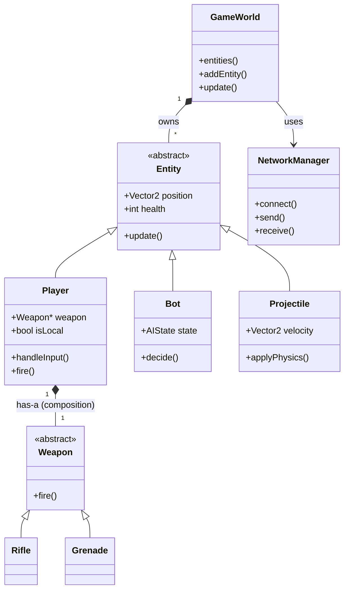
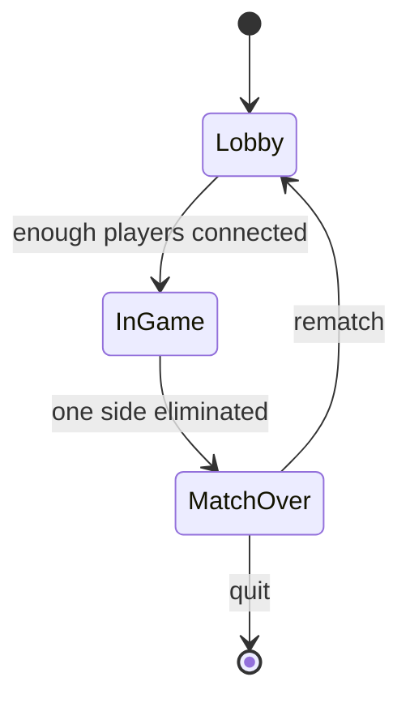
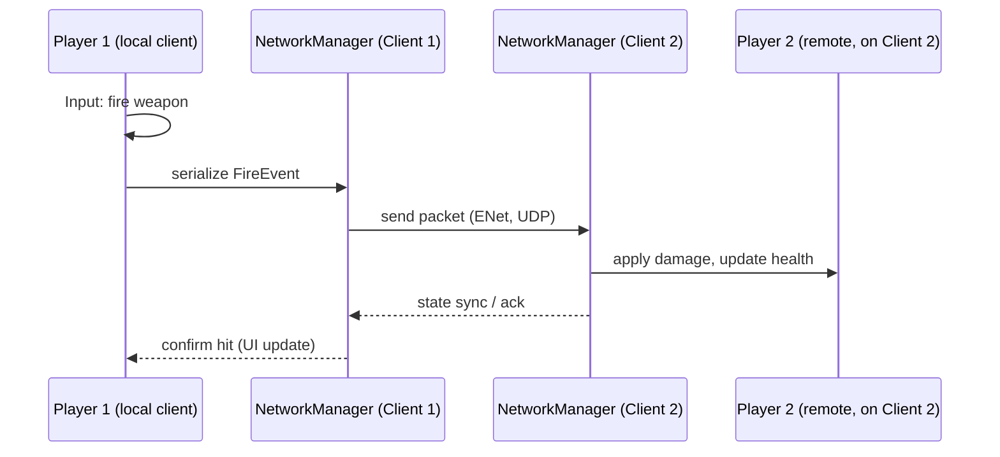
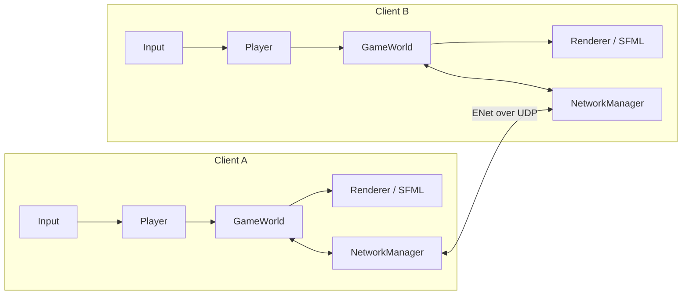
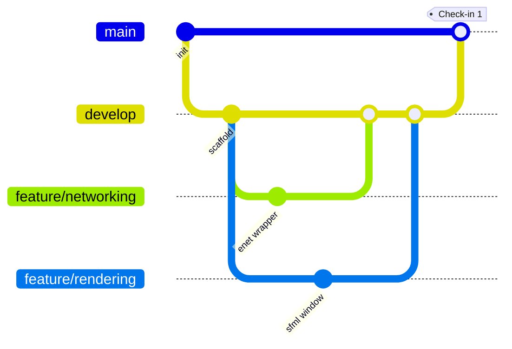

# Fireteam: Skirmish


A real-time, team-based tactical shooter for small LAN groups — built as our
CSC2210 (Procedural and Object-Oriented C++) final project. Host a match
with your friends over a local network, fill empty slots with AI bots, and
fight it out with hitscan weapons and (stretch goal) physics-based
grenades.

> **Course:** CSC2210 Procedural and Object-Oriented C++ — Dr. Chibuzo Ukegbu
> **Team:** Aditya Miriyala, Khushal Lingamaneni, Koushik Cherukuri

## Table of contents

- [About](#about)
- [Features](#features)
- [Demo](#demo)
- [Architecture](#architecture)
- [Tech stack](#tech-stack)
- [Getting started](#getting-started)
- [Project structure](#project-structure)
- [Testing](#testing)
- [Development workflow](#development-workflow)
- [Roadmap](#roadmap)
- [Documentation](#documentation)
- [License](#license)

## About

Friend groups who want a quick, casual team shootout don't have a
lightweight way to do it themselves — commercial games assume matchmaking
infrastructure or a dedicated server, which is overkill for "a few people on
the same Wi-Fi for twenty minutes." **Fireteam: Skirmish** solves that: two
or more human players connect directly over LAN, and AI bots fill any
remaining slots so a match is never blocked on having exactly the "right"
number of people.

Full project rationale, scope, and design justification are in the
[project proposal](docs/proposal.pdf).

## Features

### Core (required to work)
- Real-time networked gameplay over LAN (2+ human players) via ENet
- Player movement, aiming, and a hitscan weapon
- Hit detection and damage, synced consistently across clients
- Win condition when one side/player remains
- Clean OOP structure: polymorphic `Entity` hierarchy, RAII-wrapped
  networking, explicit `GameState` state machine

### Stretch goals
- AI-controlled bots filling empty lobby slots (scaling toward 5v5)
- Grenade/explosive weapon with real projectile physics (gravity, bounce,
  blast radius)
- Full 5v5 scale, HUD polish, sound, multiple maps

## Demo

> 🚧 **Coming soon.** A gameplay demo (recording + screenshots) will be
> added here once core features are implemented and playable end-to-end —
> we're not going to fake footage of a game that doesn't exist yet. Check
> back around Check-in 2 / the readiness check milestone.

## Architecture

### Entity & subsystem design



We use **composition** for `Player`-has-a-`Weapon` (weapons are swappable,
not baked into the player's type) but **inheritance** for the `Entity`
hierarchy, since polymorphic dispatch over one container of entities is the
natural fit for a single game-update loop. See
[docs/proposal.md](docs/proposal.md#3-design-sketch) for the full rationale.

`NetworkManager` currently wraps ENet host lifetime with RAII and exposes
server creation, client connection, server broadcast, client-to-server send,
and connection/disconnection/packet events. It carries opaque payload bytes;
application-message framing and validation belong to the game protocol,
which is not implemented yet. A localhost integration test connects separate
server/client managers and exchanges packets.
Implemented foundation: `GameWorld` owns entities with `unique_ptr`, updates
living entities, then removes dead ones. Adding a null entity or updating
with negative/non-finite elapsed time throws `std::invalid_argument`.
References to removed entities must not be used after an update.
The renderer will read entity data rather than calling `Entity::render()`;
gameplay has no SFML dependency.

`GameState` starts in `MatchPhase::Lobby` and permits only the cycle
Lobby -> InGame -> MatchOver -> Lobby. Illegal transitions throw
`std::logic_error` without changing the phase. Player-count checks and
winner detection are future work in #11, not implemented by this skeleton.

### Match state machine



### Network data flow (a shot being fired)



### Client/server component overview



## Tech stack

| Concern | Choice | Why |
|---|---|---|
| Language | C++20 | Course requirement |
| Build | CMake 3.16+ with `FetchContent` | One build system works across Windows/macOS/Linux with no manual dependency installs |
| Rendering/window/input | [SFML](https://www.sfml-dev.org/) 2.6.2 | Gentle learning curve, strong OOP fit, team's first graphics library |
| Networking | [ENet](http://enet.bespin.org/) 1.3.18 | Purpose-built for real-time game networking (sequencing/reliability over UDP), much smaller surface than general-purpose async I/O libraries |
| Testing | [doctest](https://github.com/doctest/doctest) 2.4.11 | Header-only, fast to compile, fast to run in CI |

## Getting started

### Prerequisites
- CMake ≥ 3.16
- A C++20 compiler (recent MSVC, GCC, or Clang)
- Internet connection on first configure (CMake `FetchContent` downloads
  SFML, ENet, and doctest source)

### Build

```bash
git clone https://github.com/aditya9064/c-final-project.git
cd c-final-project
cmake -S . -B build -DCMAKE_BUILD_TYPE=Release
cmake --build build --config Release --parallel
```

### Run

```bash
# macOS / Linux
./build/fireteam_skirmish

# Windows (Visual Studio generator)
build\Release\fireteam_skirmish.exe
```

This currently runs a **build/dependency smoke test** (opens a window,
draws a placeholder shape, initializes networking) rather than the full
game — see [Roadmap](#roadmap) for what's implemented so far.

## Project structure

```
c-final-project/
├── .github/            CI workflow, issue/PR templates
├── assets/             Game assets (sprites, fonts, sounds) as they're added
├── docs/                proposal, AI-use log, evidence (tests/memory diagnostics)
├── include/fireteam/    Public headers
├── src/                 Implementation (.cpp)
├── tests/                doctest-based test suite
└── CMakeLists.txt        Build configuration (FetchContent for all dependencies)
```

## Testing

```bash
cd build
ctest --output-on-failure
```

Our test plan (normal, boundary/empty, invalid-input, and failure-condition
cases) is documented in
[docs/proposal.md](docs/proposal.md#6-test-plan-and-sources) and will grow
alongside each subsystem. Memory diagnostic tool output and the required
test-evidence table will be added under `docs/` as they're produced.

## Development workflow

- `main` — always buildable/demoable, protected, merges only via reviewed PR
- `develop` — integration branch for finished feature work
- `feature/networking`, `feature/rendering`, `feature/combat` — long-lived
  branches matching subsystem ownership (see below)



Full conventions (commit style, review expectations, code style) are in
[CONTRIBUTING.md](CONTRIBUTING.md).

| Area | Owner |
|---|---|
| Core engine, game loop, `NetworkManager` | Aditya Miriyala |
| Rendering, player movement/input, HUD | Koushik Cherukuri |
| Combat systems, hit detection, AI bots, grenade physics | Khushal Lingamaneni |

(Everyone writes tests for their own subsystem and reviews teammates' PRs,
per the course's teamwork requirement — ownership above is primary
responsibility, not exclusive access.)

## Roadmap

| Week | Milestone |
|---|---|
| 9 | Proposal finalized; repo + CMake skeleton; SFML/ENet intro tutorials |
| 10 (Check-in 1) | Local 2-player movement + rendering; first unit tests; networking integration begins |
| 11 | Player movement synced across machines; hit detection begins |
| 12 (Check-in 2) | Full core loop playable end-to-end; memory diagnostics run |
| 13 | Stretch goals (bots / grenade physics) as time allows |
| 14 (Readiness check) | Fresh-clone build test using only this README; demo rehearsal |
| 15 | Final polish, report, slides, submission |

## Documentation

- [Project proposal (PDF)](docs/proposal.pdf) / [source](docs/proposal.md)
- [AI use log](docs/ai-use-log.md)
- [Contributing / branching conventions](CONTRIBUTING.md)

## License

[MIT](LICENSE)
