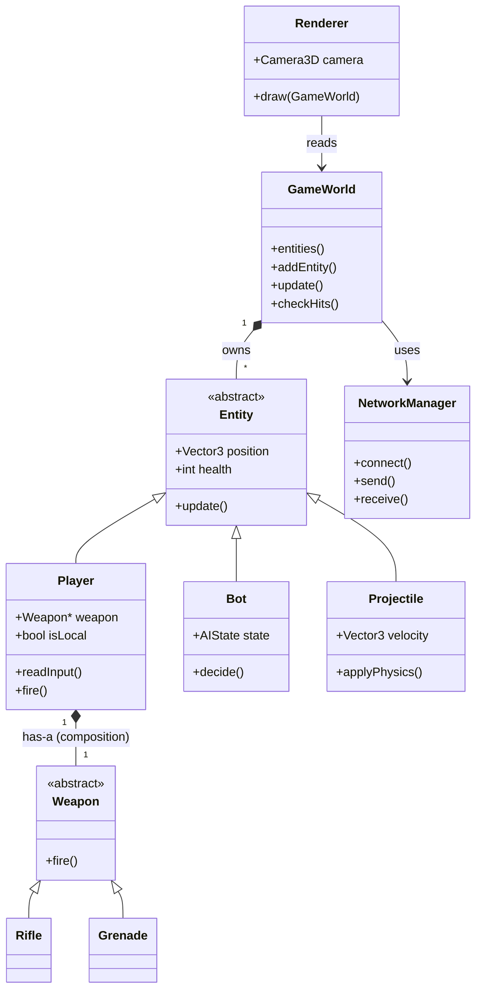
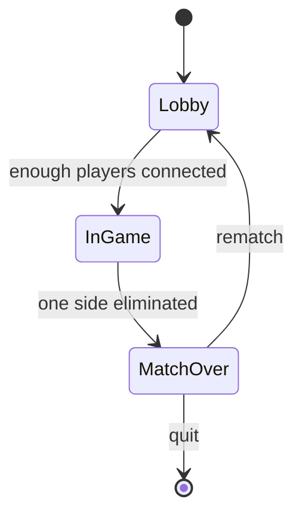
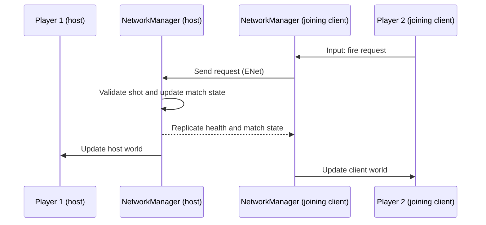
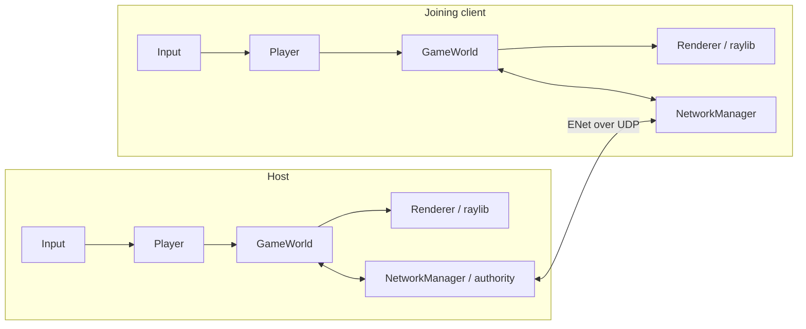
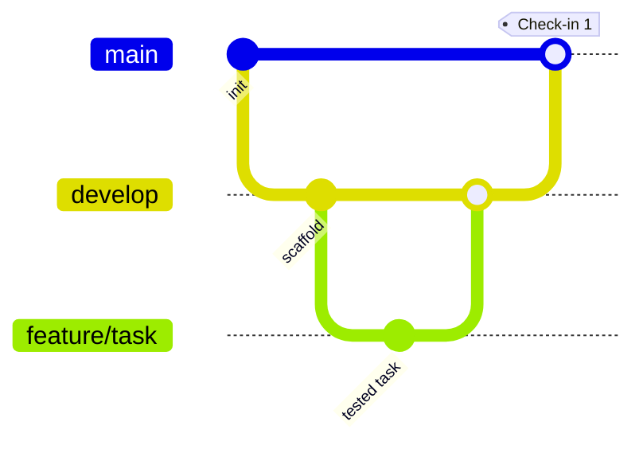

# Fireteam: Skirmish


A scoped 3D first-person shooter for two players on a local network — built
as our CSC2210 (Procedural and Object-Oriented C++) final project. Explore a
compact arena, aim and move from a first-person camera, and compete with a
hitscan rifle. Bots, grenades, and larger matches are optional stretch goals.

> **Course:** CSC2210 Procedural and Object-Oriented C++ — Dr. Chibuzo Ukegbu
> **Team:** Aditya Miriyala, Khushal Lingamaneni, Koushik Cherukuri

## Table of contents

- [About](#about)
- [Features](#features)
- [Demo](#demo)
- [Architecture](#architecture)
- [Tech stack](#tech-stack)
- [Getting started](#getting-started)
- [Project structure](#project-structure)
- [Testing](#testing)
- [Development workflow](#development-workflow)
- [Roadmap](#roadmap)
- [Documentation](#documentation)
- [License](#license)

## About

**Fireteam: Skirmish** is a small 3D first-person LAN shooter. Its core goal
is a playable two-player match in one compact arena: first-person movement
and mouse-look, one hitscan rifle, 3D hit detection, health, elimination,
and a match result. The host owns authoritative match state; ENet carries
the messages between instances. A 5v5 mode, bots, grenades, and extra maps
are stretch goals, not prerequisites for a complete project.

Full project rationale, scope, and design justification are in the
[project proposal](docs/proposal.md) ([PDF](docs/proposal.pdf)).

## Features

### Core (required to work)
- Real-time networked gameplay for two human players over LAN via ENet
- 3D first-person movement and mouse-look in one compact arena
- One hitscan rifle, 3D hit detection, health and elimination
- Host-authoritative match result, replicated to both players
- Clean OOP structure: polymorphic `Entity` hierarchy, RAII-wrapped
  networking, explicit `GameState` state machine

### Stretch goals
- AI-controlled bots filling empty lobby slots (scaling toward 5v5)
- Grenade/explosive weapon with real projectile physics (gravity, bounce,
  blast radius)
- Full 5v5 scale, HUD polish, sound, multiple maps

## Demo

> 🚧 **Coming soon.** A gameplay demo (recording + screenshots) will be
> added here once core features are implemented and playable end-to-end —
> we're not going to fake footage of a game that doesn't exist yet. Check
> back around Check-in 2 / the readiness check milestone.

## Architecture

### Entity & subsystem design



We use **composition** for `Player`-has-a-`Weapon` (weapons are swappable,
not baked into the player's type) but **inheritance** for the `Entity`
hierarchy, since polymorphic dispatch over one container of entities is the
natural fit for a single game-update loop. See
[docs/proposal.md](docs/proposal.md#3-design-sketch) for the full rationale.

Implemented foundation: `GameWorld` owns entities with `unique_ptr`, updates
living entities, then removes dead ones. Adding a null entity or updating
with negative/non-finite elapsed time throws `std::invalid_argument`.
References to removed entities must not be used after an update.
The renderer reads entity data rather than calling `Entity::render()`, and
the gameplay core does not depend on raylib.

`GameState` starts in `MatchPhase::Lobby` and permits only the cycle
Lobby -> InGame -> MatchOver -> Lobby. Illegal transitions throw
`std::logic_error` without changing the phase. Player-count checks and
winner detection are future work in #11, not implemented by this skeleton.
The renderer uses raylib's 3D camera and drawing API, keeping gameplay and
collision rules separate from rendering. `NetworkManager` will wrap ENet
host lifetime with RAII; application message framing, validation, and
host-authoritative state replication remain part of the planned game protocol.
`Vector3` now supplies the 3D math used by entity positions and movement.
`Vector2` remains available for genuinely 2D uses such as HUD layout.

### Match state machine



### Host-authoritative network data flow (a shot being fired)



### Client/server component overview



## Tech stack

| Concern | Choice | Why |
|---|---|---|
| Language | C++20 | Course requirement |
| Build | CMake 3.16+ with `FetchContent` | One build system works across Windows/macOS/Linux with no manual dependency installs |
| Rendering/window/input | [raylib](https://www.raylib.com/) 5.5 | Direct 3D camera, drawing, and input APIs suitable for a compact FPS prototype |
| Networking | [ENet](http://enet.bespin.org/) 1.3.18 | Purpose-built for real-time game networking (sequencing/reliability over UDP), much smaller surface than general-purpose async I/O libraries |
| Testing | [doctest](https://github.com/doctest/doctest) 2.4.11 | Header-only, fast to compile, fast to run in CI |

## Getting started

### Prerequisites
- CMake ≥ 3.16
- A C++20 compiler (recent MSVC, GCC, or Clang)
- Internet connection on first configure (CMake `FetchContent` downloads
  raylib, ENet, and doctest source)

### Build

```bash
git clone https://github.com/aditya9064/c-final-project.git
cd c-final-project
cmake -S . -B build -DCMAKE_BUILD_TYPE=Release
cmake --build build --config Release --parallel
```

### Run

```bash
# macOS / Linux
./build/fireteam_skirmish

# Windows (Visual Studio generator)
build\Release\fireteam_skirmish.exe
```

This currently runs a **build/dependency smoke test** (opens a window,
draws a placeholder 3D scene, initializes networking) rather than the full
game. Gameplay and the networking protocol still need to be ported to the
approved 3D scope.

## Project structure

```
c-final-project/
├── .github/            CI workflow, issue/PR templates
├── assets/             Game assets (models, textures, fonts, sounds) as added
├── docs/                proposal, AI-use log, evidence (tests/memory diagnostics)
├── include/fireteam/    Public headers
├── src/                 Implementation (.cpp)
├── tests/                doctest-based test suite
└── CMakeLists.txt        Build configuration (FetchContent for all dependencies)
```

## Testing

```bash
cd build
ctest --output-on-failure
```

Our test plan (normal, boundary/empty, invalid-input, and failure-condition
cases) is documented in
[docs/proposal.md](docs/proposal.md#6-test-plan-and-sources) and will grow
alongside each subsystem. Memory diagnostic tool output and the required
test-evidence table will be added under `docs/` as they're produced.

## Development workflow

- `main` — always buildable/demoable, protected, merges only via reviewed PR
- `develop` — integration branch for finished feature work
- Short-lived `feature/*` task branches start from `develop` and merge back
  after review and passing checks



Full conventions (commit style, review expectations, code style) are in
[CONTRIBUTING.md](CONTRIBUTING.md).

| Area | Owner |
|---|---|
| Core engine, game loop, `NetworkManager` | Aditya Miriyala |
| raylib 3D rendering, camera, player controls, HUD | Koushik Cherukuri |
| Weapons, 3D hit detection, optional bots/grenade | Khushal Lingamaneni |

(Everyone writes tests for their own subsystem and reviews teammates' PRs,
per the course's teamwork requirement — ownership above is primary
responsibility, not exclusive access.)

## Roadmap

| Week | Milestone |
|---|---|
| 9 | Proposal and repository foundation |
| 10 (Check-in 1) | Local 3D arena, first-person movement/look, initial unit tests |
| 11 | Two instances exchange player state; hit detection and damage integrated |
| 12 (Check-in 2) | Two-player core match playable; memory diagnostics run |
| 13 | Stabilize core; optional goals only if required features are reliable |
| 14 (Readiness check) | Fresh-clone build test using only this README; demo rehearsal |
| 15 | Final polish, report, slides, submission |

## Documentation

- [Project proposal (PDF)](docs/proposal.pdf) / [source](docs/proposal.md)
- [AI use log](docs/ai-use-log.md)
- [Contributing / branching conventions](CONTRIBUTING.md)

## License

[MIT](LICENSE)
